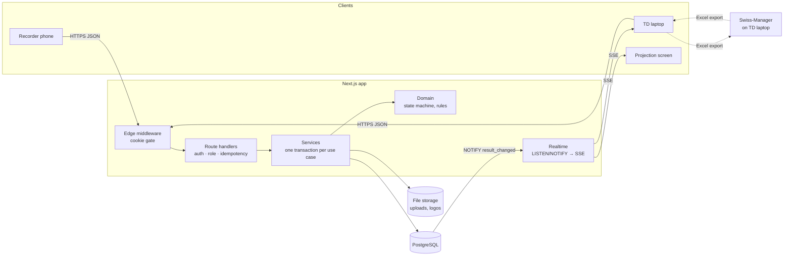
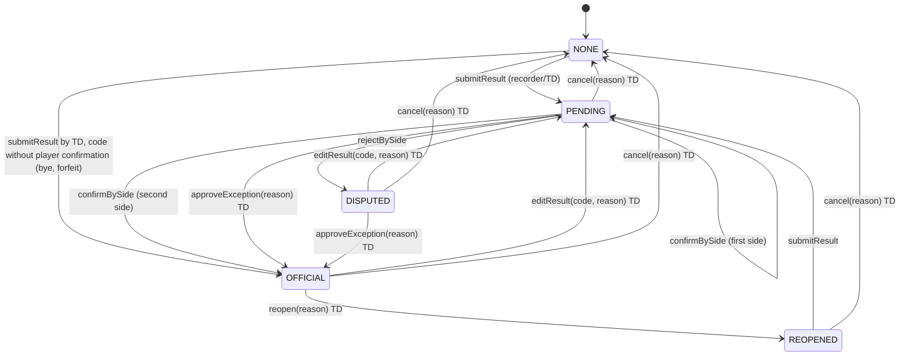

# USCC Referee Results Web

Internal web app for **USCC** (a chess club in Ho Chi Minh City) that lets arbiters run tournament results without printed pairing lists.

> **Status: Phase 1 (Foundation) complete.** Accounts, login/logout, sessions, role guards, account management, database schema, seed data. Result entry, projection, import and export come in Phases 2–5 (see [AGENT_PROMPT.md](AGENT_PROMPT.md) §4). Sections below mark features that are not built yet as *(Phase N)*.

---

## 1. Introduction

**Who uses it**

- **Technical arbiter (TD, `TECHNICAL`)**: creates tournaments, imports pairings exported from Swiss-Manager, resolves disputes, opens the projection screen, exports results back to Swiss-Manager, and manages accounts.
- **Result recorder (`RECORDER`)**: finds a board on their phone, enters the result, then hands the phone to White and then to Black, who confirm in turn. Players have no accounts.

**Problem it solves.** At venues with no printer, players crowd the arbiter's laptop to find their board, results are relayed by voice or paper slips, and wrong results are found only after the next round is paired. The app gives arbiters a fast, verified and logged channel between the playing area and Swiss-Manager.

**Core rule.** A result becomes **OFFICIAL** only after both players confirm it, or after a TD approves an exception with a reason. Only official results appear on the projection screen and in default exports.

**Out of scope (v1).** The app does not:

- generate pairings, tiebreaks or official standings (Swiss-Manager does this),
- connect directly to the Swiss-Manager database (Excel files only),
- have a native mobile app, registration, payments or membership management,
- have player or spectator accounts, or any public page,
- resolve disputes automatically (the TD decides),
- calculate ratings or publish to Chess-Results.

## 2. Features

| Role | Feature | Status |
|---|---|---|
| Both | Login / logout; sessions end after 16 h of inactivity | ✅ Phase 1 |
| Both | Tournament list on the home page | ✅ Phase 1 (read-only) |
| TD | Account management: create, deactivate, reactivate, reset password | ✅ Phase 1 |
| TD | Tournament settings, branding, result codes | Phase 2 |
| TD | Manual pairing entry | Phase 2 |
| Both | Pairing list with search by board, name (diacritics ignored) or player ID | Phase 2 |
| Both | Result entry and two-player confirmation on the recorder's phone | Phase 2 |
| TD | Console: dispute queue, approve / edit / cancel / reopen with reason, audit history | Phase 2 |
| TD | Live projection screen (official results within 5 s) | Phase 3 |
| Recorder | Offline queue with "Chưa đồng bộ (N)" badge | Phase 3 |
| TD | Excel import wizard (mapping, preview, row/column errors, diff) | Phase 4 |
| TD | Excel export (official only by default; pending/disputed separately) | Phase 4 |
| Ops | Production Docker image, Caddy HTTPS, backups, rate limiting, CSRF token, Sentry | Phase 5 |

## 3. Architecture overview

**Stack:** TypeScript (strict) · Next.js 15 App Router · React 19 · Tailwind CSS 3 · PostgreSQL 16 · Prisma 5 · Zod 3 · argon2 · ExcelJS *(Phase 4)* · Server-Sent Events over PostgreSQL LISTEN/NOTIFY *(Phase 3)* · IndexedDB via `idb` *(Phase 3)* · Vitest · Playwright · Docker Compose + Caddy.



**Request pipeline (every authenticated API route).** Same-origin check on mutations → session lookup in the database (401) → role permission from the SRS §4.1 matrix (403) → Zod validation (400) → `Idempotency-Key` check and one transaction that holds both the change and the stored response → JSON error `{ code, messageVi }`.

**Result lifecycle** (implemented in Phase 2 in `src/server/domain/result-state-machine.ts`, the only code allowed to change a result's status):



`editResult` is also allowed from PENDING and REOPENED (back to PENDING); `editResult` and `cancel` are never allowed from NONE. Every TD reason (approve, reopen, edit, cancel) must be at least 5 characters (SRS-SM-05 to SRS-SM-08).

Every transition checks and increments `version` (409 on a stale version), writes a `result_events` row, and fires `NOTIFY result_changed`, all in one transaction. `result_events` is append-only, enforced by a database trigger.

## 4. Project structure

```
src/
  app/                  routes and route handlers only (no business logic)
    api/auth/           login, logout (the only public API route is login)
    api/users/          account management API (TD)
    admin/users/        account management page (TD)
    login/  forbidden/  public login page; access-denied page
  components/           presentational React components
  client/               browser-only helpers (API calls with Idempotency-Key; offline queue in Phase 3)
  i18n/vi.ts            every Vietnamese UI string
  middleware.ts         Edge gate: no session cookie → /login or 401
  server/
    auth/               password hashing, session tokens and store, cookies, permission matrix, guards
    config/             validated environment variables
    database/           shared Prisma client and transaction client type
    domain/             pure business rules (no DB, no HTTP)
    http/               ApiError and the route-handler wrapper
    services/           DB-backed use cases (auth, accounts, idempotency, queries)
    import/ export/ realtime/   Phases 3–4
prisma/                 schema.prisma, migrations/, seed.ts
tests/
  unit/                 pure modules (Vitest)
  integration/          services and route handlers against the test database (Vitest)
  e2e/                  browser flows (Playwright, mobile 390×844 and desktop 1440×900)
  helpers/              test database preparation and fixtures
docker/                 Dockerfile, Caddyfile (draft; finished in Phase 5)
docs/                   BRD, SRS, PRD, technical notes, Chess-Results sample workbook
```

## 5. Prerequisites

| Tool | Version used for development | Minimum |
|---|---|---|
| Node.js | 24.x | 20 LTS |
| pnpm | 12.x | 9 |
| Docker (with Compose v2) | Docker Desktop 4.x / Engine 29 | Compose v2 |
| PostgreSQL | 16 (via the `postgres:16-alpine` image) | 16 |

On Windows, run the commands below in Git Bash or PowerShell.

## 6. Setup, step by step

1. **Clone and install.**
   ```bash
   git clone <repository-url> uscc-referee-results
   ```
   ```bash
   cd uscc-referee-results
   ```
   ```bash
   pnpm install
   ```
   `pnpm install` also runs `prisma generate`. Native builds (argon2, Prisma engines, esbuild) are allowed in `pnpm-workspace.yaml`.

2. **Create your environment file.**
   ```bash
   cp .env.example .env
   ```
   Change `POSTGRES_PASSWORD` and the matching password inside `DATABASE_URL` and `TEST_DATABASE_URL` if you like; the defaults work locally.

3. **Start PostgreSQL.**
   ```bash
   docker compose up -d
   ```

4. **Apply migrations.**
   ```bash
   pnpm db:migrate
   ```

5. **Seed demo data**: one TD, one recorder, the tournament "Giải Demo USCC 2026" with 2 rounds × 10 boards, 20 fictional players and the default result codes. Safe to re-run.
   ```bash
   pnpm db:seed
   ```

6. **Start the dev server** and open http://localhost:3000.
   ```bash
   pnpm dev
   ```

**Demo logins (local development only):**

| Role | Username | Password |
|---|---|---|
| TECHNICAL | `td_demo` | `TdDemo-2026!` |
| RECORDER | `recorder_demo` | `RecDemo-2026!` |

Override them with the `SEED_*` variables before seeding. Never use these accounts on a deployed server.

### Environment variables

| Variable | Required | Meaning |
|---|---|---|
| `DATABASE_URL` | yes | PostgreSQL URL used by Prisma and the app. |
| `POSTGRES_DB`, `POSTGRES_USER`, `POSTGRES_PASSWORD`, `POSTGRES_PORT` | for docker compose | Initialise the PostgreSQL container; must match `DATABASE_URL`. |
| `TEST_DATABASE_URL` | for integration tests | Separate database; its name must contain `test`. Created and migrated automatically by `pnpm test:integration`. |
| `APP_URL` | yes in production | Public origin, e.g. `https://kq.example.org`. Mutations whose `Origin` header differs are rejected. Default `http://localhost:3000`. |
| `SESSION_IDLE_TIMEOUT_HOURS` | no | Hours of inactivity before a session ends (SRS-AUTH-04). Default `16`. |
| `SESSION_COOKIE_SECURE` | no | `true`/`false` to force the cookie's Secure flag. Default: on in production, off in development. |
| `NODE_ENV` | no | `development`, `test` or `production`. |
| `SEED_TD_USERNAME`, `SEED_TD_PASSWORD`, `SEED_RECORDER_USERNAME`, `SEED_RECORDER_PASSWORD` | no | Override the demo accounts created by `pnpm db:seed`. |
| `SENTRY_DSN` | no | Error tracking *(wired in Phase 5)*. |

Older `.env` files may still contain `SESSION_SECRET`, `SESSION_MAX_AGE_SECONDS` and `NEXT_PUBLIC_APP_URL`. Nothing reads them any more, because sessions are random tokens stored in the database. Remove them.

## 7. Usage guide

### Technical arbiter (TD)

**Create an arbiter account**
1. Sign in at `/login` with a TECHNICAL account.
2. Click **Tài khoản** in the header (`/admin/users`).
3. Under **Tạo tài khoản mới**, enter a username (3–40 characters: lowercase letters, digits, `.`, `_` or `-`), a password of at least 10 characters, and a role. Click **Tạo tài khoản**.
4. To lock someone out, click **Vô hiệu hóa**. Their sessions end immediately. You cannot deactivate yourself or the last active TD.
5. To change a password, click **Đặt lại mật khẩu**. The user's existing sessions end.

The first TD account comes from the seed script in development. For production, see §9.

**Create a tournament, enter or import pairings, run the console, open the projection screen, export Excel** *(Phases 2–4)*: these steps will be written as each phase lands.

### Recorder

1. Sign in at `/login` on your phone with a RECORDER account.
2. The home page lists tournaments and their rounds.
3. Find a board, enter the result and run the two-player confirmation *(Phase 2)*.

## 8. Testing

| Command | What it runs | Needs |
|---|---|---|
| `pnpm lint` | ESLint (Next.js + TypeScript rules, zero warnings allowed) | — |
| `pnpm typecheck` | `tsc --noEmit` in strict mode | — |
| `pnpm test:unit` | Vitest, `tests/unit`: session tokens, argon2 hashing, the SRS §4.1 permission matrix cell by cell, origin check, Zod input schemas, deactivation rules, date formatting, default result codes, idempotency keys | — |
| `pnpm test:integration` | Creates and migrates `TEST_DATABASE_URL`, then Vitest `tests/integration`: login and sessions (expiry, sliding refresh, deactivation lockout), account management (last-TD rule, session termination), idempotency (replay, concurrent duplicates, reused key), real `/api/users` and `/api/auth/login` handlers (401, 403, CSRF origin, missing key, cookie flags), and the append-only trigger on `result_events` | Docker PostgreSQL |
| `pnpm test:e2e` | Playwright on mobile (390×844) and desktop (1440×900): anonymous redirect, 401 API, wrong password, TD login → accounts → logout, recorder blocked from accounts | Docker PostgreSQL, `pnpm db:seed`; starts `pnpm dev` itself if not running |
| `pnpm test:all` | unit + integration + e2e | all of the above |

Run `pnpm exec playwright install chromium` once before the first e2e run. Failure traces, screenshots and videos are saved in `test-results/`, and the HTML report in `playwright-report/`. The `.docx` test-run report generator (TEST_AGENT_PROMPT.md) is not built yet.

## 9. Deployment *(Phase 5)*

The production Dockerfile, Caddy config, backup script and restore procedure are delivered and tested in Phase 5. Drafts are in `docker/`. Until then:

- Run behind HTTPS only, with `NODE_ENV=production` so the session cookie is `Secure`.
- Set `APP_URL` to the public origin.
- Create the first TD account by running the seed with `SEED_TD_*` set, then delete the demo recorder and tournament. A dedicated `create-admin` command is planned for Phase 5.

## 10. Configuration reference

**Result codes.** Each tournament has its own list (`result_codes`). New tournaments get the SRS-TOUR-06 defaults below. **The list and the Swiss-Manager values are a proposal (open question OI-03); the TD must confirm them before round 1.**

| Code | Label | White | Black | Players confirm? | Swiss-Manager value (placeholder) |
|---|---|---|---|---|---|
| `1-0` | Trắng thắng | 1 | 0 | yes | `1-0` |
| `0-1` | Đen thắng | 0 | 1 | yes | `0-1` |
| `½-½` | Hòa | ½ | ½ | yes | `½-½` |
| `+/-` | Trắng thắng do Đen bỏ cuộc | 1 | 0 | no | `+/-` |
| `-/+` | Đen thắng do Trắng bỏ cuộc | 0 | 1 | no | `-/+` |
| `-/-` | Cả hai bỏ cuộc | 0 | 0 | no | `-/-` |
| `BYE` | Miễn đấu (1 điểm) | 1 | 0 | no | `+` |
| `BYE½` | Miễn đấu (½ điểm) | ½ | 0 | no | `½` |
| `BYE0` | Miễn đấu (0 điểm) | 0 | 0 | no | `-` |

Codes with "Players confirm? = no" go straight to OFFICIAL when a TD submits them, and are never displayed as "confirmed by both players". Scores are stored as `DECIMAL` (½ = 0.5) and shown as ½.

**Timezone.** Each tournament has an IANA timezone, `Asia/Ho_Chi_Minh` by default. Timestamps are stored as `timestamptz` (UTC) and displayed as `DD/MM/YYYY HH:mm` (24-hour) in that zone. Tournament start and end dates are calendar dates (`DATE`).

**Branding.** Each tournament has a primary and secondary colour (applied through the CSS variables `--brand-primary` and `--brand-secondary`) and a logo *(editing UI in Phase 2)*.

**Sessions.** Opaque 256-bit tokens in an `HttpOnly`, `SameSite=Lax` cookie (`Secure` in production). Only the token's SHA-256 hash is stored. Sessions slide forward on activity and end after `SESSION_IDLE_TIMEOUT_HOURS` without activity, on logout, on deactivation or on a password reset.

## 11. Known limitations and open questions

**Open questions (do not guess; owners per SRS §13):**

1. **OI-01:** The real Swiss-Manager pairing export and the Swiss-Manager version USCC uses have not been provided. The importer (Phase 4) will use user-driven column mapping; the Chess-Results sample in `docs/` is a test fixture only.
2. **OI-02:** Whether that Swiss-Manager version can re-import results from Excel, and in what layout. Until confirmed, the exporter writes a generic workbook isolated in one module.
3. **OI-03:** The final result-code list and Swiss-Manager values. The defaults in §10 are a proposal. **Assumption:** forfeits and byes do not require player confirmation, because at least one player is absent.
4. **OI-04:** The procedure when a player disputes a result or cannot confirm it personally. Needed before Phase 2 ends.
5. **OI-05:** Hosting provider, budget and data-retention period.
6. **OI-06:** Session lifetime (16 h implemented) and login-lock thresholds (5 tries / 10 min proposed; built in Phase 5).
7. **OI-07:** Capacity figures (200 players, 10 recorders) are estimates.

**Conflicts between documents** (AGENT_PROMPT.md wins per CLAUDE.md, flagged for a decision):

- *Resolved 2026-10-30:* the SRS state-machine rules are adopted: `cancel(reason)` → NONE is added, `edit` is allowed from any state except NONE, and TD reasons need at least 5 characters. AGENT_PROMPT §3.3 has been updated to match.
- The SRS lists login rate limiting (SRS-AUTH-05) and a CSRF token (SRS §10.2) as auth requirements; AGENT_PROMPT schedules them for Phase 5. Phase 1 ships an `Origin` check plus `SameSite=Lax` as the interim CSRF defence, and **no login rate limiting yet**.

**Current limitations:**

- `/api/auth/login` and `/api/auth/logout` do not require an `Idempotency-Key`. Repeating them is harmless, and the offline queue never replays them. Every other mutating endpoint requires one.
- Idempotency records are kept until `deleteExpiredIdempotencyRecords` is scheduled (planned with the Phase 5 maintenance jobs; SRS asks for at least 48 h retention).
- Deleting a tournament or result that has audit history is blocked by the append-only trigger by design. There is no delete feature.
- The home page lists rounds as plain text. Round pages arrive in Phase 2.
- Tournaments cannot be created from the UI yet (Phase 2); use the seed.

## 12. Troubleshooting

| Symptom | Fix |
|---|---|
| `Can't reach database server at localhost:5432` | Start Docker Desktop, then `docker compose up -d`. Check with `docker compose ps`. If port 5432 is taken, set `POSTGRES_PORT` and update the port in `DATABASE_URL`. |
| `@prisma/client did not initialize yet` | Run `pnpm db:generate` (the client is stale after a schema change). |
| `Invalid server environment — …` on start | A variable in `.env` is missing or malformed. Compare with `.env.example`. |
| Migration fails with `relation already exists` | The dev database has tables from an older schema. Only on your local dev DB: `pnpm exec prisma migrate reset`. This deletes all local data. |
| `ERR_PNPM_IGNORED_BUILDS` during install | Make sure `pnpm-workspace.yaml` is present; it allows the argon2 and Prisma build scripts. |
| Login works but you are immediately sent back to `/login` | You are on plain `http://` with `NODE_ENV=production`, so the `Secure` cookie is dropped. Use HTTPS, or set `SESSION_COOKIE_SECURE=false` for local testing only. |
| Mutations return `403 CROSS_ORIGIN_REJECTED` | `APP_URL` does not match the address in the browser (scheme, host and port must all match). |
| `Refusing to use database … for tests` | `TEST_DATABASE_URL` must name a database containing `test`. |
| SSE stops behind a proxy *(Phase 3)* | Disable response buffering for `/api/tournaments/*/events` in the proxy; Caddy streams by default. |
