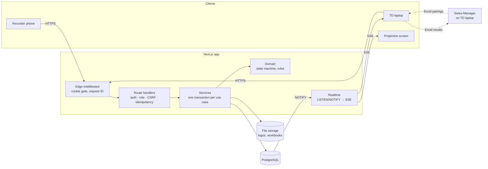
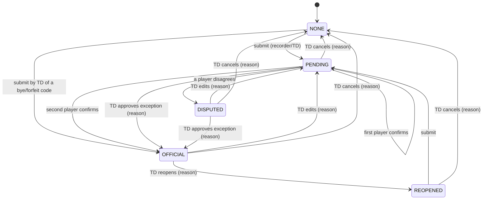

# USCC Referee Results Web

**Web app for chess arbiters at USCC tournaments.** Arbiters record each result on a phone at the board, both players confirm it on that phone, the result appears on a projection screen within seconds, and the technical arbiter exports everything back to Swiss-Manager. No printed pairing lists or paper slips are needed.

> **Status:** all five build phases are complete (see [§4](#4-building-phases)). Before the first live tournament, resolve the open questions in [§9](#9-known-limitations-and-open-questions): a real Swiss-Manager file, the final result codes, the dispute procedure, and hosting and data retention. Then run the deployment drill on the real server.

**Contents**
1. [Introduction](#1-introduction)
2. [Features](#2-features)
3. [How to use](#3-how-to-use)
4. [Building phases](#4-building-phases)
5. [Setup](#5-setup)
6. [Testing](#6-testing)
7. [Architecture and project structure](#7-architecture-and-project-structure)
8. [Configuration reference](#8-configuration-reference)
9. [Known limitations and open questions](#9-known-limitations-and-open-questions)
10. [Troubleshooting](#10-troubleshooting)

---

## 1. Introduction

### What it is

USCC Referee Results Web is an internal, login-only web application for **USCC**, a chess club in Ho Chi Minh City. It sits between **Swiss-Manager**, the desktop program the technical arbiter uses to pair rounds and compute standings, and the **playing area**, where games finish and results must be collected. The interface is in Vietnamese and works on any modern phone or laptop browser; nothing has to be installed.

### Its purpose

At venues without a printer, USCC has had no reliable way to show pairings or collect results:
- players crowd the arbiter's laptop to find their board;
- results are relayed by voice or on paper slips, then retyped into Swiss-Manager by hand;
- nobody records that both players agreed, so a wrong result (for example, swapped colours) is often found only after the next round is paired;
- when a result is changed, nobody can later show who changed it, when, or why.

The app gives the club a channel from the board to Swiss-Manager that is **fast, verified and recorded**:
1. Results are entered at the board, the moment the game ends.
2. **Both players confirm** each result on the recorder's phone. A result becomes **official** only after both confirmations, or after the technical arbiter approves an exception with a written reason.
3. Official results appear on the projection screen **within 5 seconds**. Unconfirmed or disputed results never appear there.
4. Every change is logged with who, when, why, and the old and new values.
5. The technical arbiter exports official results, with the winner of each game, to Excel or XML for Swiss-Manager in one step.

### Who uses it

| User | Role in the app | Device | What they do |
|---|---|---|---|
| **Technical arbiter (TD)**, *Trọng tài kỹ thuật* | `TECHNICAL`, with full rights | Laptop connected to the projector, plus a phone | Creates tournaments and accounts, imports pairings, resolves disputes, opens the projection screen, exports results |
| **Result recorder**, *Trọng tài ghi kết quả* | `RECORDER` | Phone | Finds a board, enters the result, hands the phone to White and then to Black for confirmation |
| **Players** | No account | The recorder's phone | Tap **Xác nhận** (confirm) or **Không đồng ý** (disagree) on their own screen, one at a time |
| **Spectators** | No account | The projector | Watch official results appear |

Only arbiters with accounts can open the site. There is no public page and no self-registration.

### How it compares with what USCC uses today

| Need | Paper slips and retyping (current practice) | Swiss-Manager alone | Chess-Results (public results site) | Shared spreadsheet or online form | **USCC Referee Results Web** |
|---|---|---|---|---|---|
| Find your board without a printed list | Crowd around the laptop | Only on the TD's laptop | Public page, if the TD uploads pairings | Possible, but not built for it | ✅ Search by board, name (accents optional) or ID on any arbiter's phone |
| Record the result at the board | Slip carried to the TD | No; the TD types it in | No; it shows results the TD has already entered | Typed by whoever has access | ✅ Recorder's phone, at the board |
| Proof that **both players agreed** | ❌ | ❌ | ❌ | ❌ | ✅ Each player confirms on their own screen, and the confirmation is logged |
| Unconfirmed or disputed results kept off public display | ❌ | ❌ | ❌ | ❌ | ✅ Enforced by the server |
| Live display at the venue | ❌ | ❌ | Updates when the TD uploads | Manual refresh | ✅ Projection screen, within 5 s (measured about 0.1 s locally) |
| Who changed a result, when and why | ❌ | ❌ | ❌ | Partial edit history | ✅ Append-only audit log with a reason for every TD change |
| Two arbiters entering the same board at once | Conflicting slips | n/a | n/a | Last write wins silently | ✅ First entry wins; the second gets a clear "reload" message |
| Works through Wi-Fi drops | n/a | n/a | ❌ | ❌ | ✅ Actions queue on the phone and sync exactly once |
| Getting results back into Swiss-Manager | Retype every result | n/a | n/a | Copy by hand | ✅ One Excel or XML export of official results |
| Access control | Whoever holds the paper | The TD's laptop | Public | Link sharing | ✅ Accounts with two roles, HTTPS, login lockout |

The app does **not** replace Swiss-Manager or Chess-Results. Swiss-Manager still pairs rounds and computes standings, and Chess-Results can still publish them. The app covers the part neither does: collecting **verified** results at the board and feeding them back.

**Out of scope (v1):** generating pairings, tiebreaks or standings; connecting directly to the Swiss-Manager database; native mobile apps; registration, payments or membership; player or spectator accounts; automatic dispute resolution; rating calculation.

---

## 2. Features

| Role | Feature |
|---|---|
| Both | Login with sessions that end after 16 h of inactivity; account locks for 10 minutes after 5 failed logins |
| Both | Round list with search by board, name (Vietnamese accents optional) or player ID, a status filter and live updates |
| Recorder | Result entry and two-player confirmation on the phone; each step locks after one tap and resumes if the page closes |
| Recorder | Offline queue: actions are saved on the phone while the network is down, a **Chưa đồng bộ (N)** badge shows them, and they are sent exactly once later |
| TD | Tournaments: details, colours with a readability warning, logo, result codes |
| TD | Pairings: manual board entry, or an Excel import wizard with column mapping, per-cell errors and a diff before anything is replaced |
| TD | Console: live status counts, a dispute queue, approve / edit / reopen / cancel with a reason, full history per game |
| TD | Projection screen: official results only, branded, large text, automatic paging, last-sync time, offline banner |
| TD | Excel or XML export: one round or the whole tournament, official results by default, plus a separate reconciliation file; every row names the winner |
| TD | Account management: create, deactivate, reactivate, reset password |
| Ops | Docker deployment with automatic HTTPS, backups every 15 minutes, a tested restore, structured logs |

---

## 3. How to use

The demo data from `pnpm db:seed` (see [§5](#5-setup)) gives you a TD account, a recorder account and a demo tournament to try every step below.

**Finding a tournament.** The home page (`/`) and **Giải đấu** (`/tournaments`) list tournaments newest first, 15 per page, with **Trang trước** / **Trang sau** below the list. Each tournament shows its number of official won and drawn games.
- **Tìm giải đấu:** type part of the name, venue or organizer. Accents and capitals don't matter, so `co nhanh` finds "Cờ Nhanh".
- **Sắp xếp theo:** date (newest or oldest first), name (A–Z), tournament ID, most won games or most drawn games. Byes don't count as games, and only official results are counted.
- Click **Áp dụng** to search or re-sort, and **Xóa bộ lọc** to go back to the default list. The address bar keeps the search, order and page (`?q=…&sort=…&page=…`), so a link opens the same view.

### 3.1 Technical arbiter: before the tournament

1. **Sign in** at `/login` with a TECHNICAL account.
2. **Create arbiter accounts.** Click **Tài khoản** (`/admin/users`), then **Tạo tài khoản mới**. Usernames are 3–40 characters (lower-case letters, digits, `.`, `_`, `-`), and passwords at least 10 characters. Pick the role, then click **Tạo tài khoản**.
3. **Create the tournament.** Click **Giải đấu** (`/tournaments`), fill in **Tạo giải đấu mới** (name, dates, venue, organizer, number of rounds 1–20, timezone, colours), then click **Tạo giải đấu**. A yellow note warns if a colour makes white text hard to read on the projector.
4. **Check the result codes.** On the settings page, under **Mã kết quả**, confirm or adjust the nine default codes and their Swiss-Manager values. Edit a row and click **Lưu**, click **Ẩn** to hide a code you don't use, or click **Thêm mã** to add one. A code that results already use can only be hidden, relabelled or re-ordered.
5. **Upload the logo** (optional): PNG, JPEG or SVG, at most 2 MB, under **Logo**.

### 3.2 Technical arbiter: each round

1. **Load the pairings.** Use one of two methods:
   - **Import from Excel** (**Nhập từ Excel**, `/tournaments/[id]/import`):
     1. Choose the round and the `.xlsx` file exported from Swiss-Manager (at most 5 MB).
     2. Pick the sheet and check the detected header row.
     3. Map each column: board number, White name and Black name are required; IDs, clubs and points are optional. The mapping is remembered for the next round.
     4. Check the preview. Every problem is listed as `Sheet "…", dòng N, cột X: …`. Fix the file and upload it again, or tick **Bỏ qua dòng này** for each row to leave out. When one name matches several players, choose the right one or **Tạo kỳ thủ mới**. Players are never merged automatically.
     5. Check the diff. If boards that already have results would change, tick the extra confirmation; their results are cancelled with a logged reason.
     6. Click **Xác nhận nhập**. The whole round is written at once, or nothing is.
   - **Enter boards by hand:** on the settings page, under **Nhập cặp đấu**, choose the round, then type each board: board number, White and Black ID, name, club and points. Leave Black empty for a bye.
2. **Open the projection screen** on the projector laptop: **Màn hình trình chiếu** opens `/tournaments/[id]/projection` in a new tab. Press F11 for full screen. Add `?round=2` to choose a round, or `&pageSeconds=15` to change the paging speed (5–30 s).
3. **Watch the console** (`/tournaments/[id]/console`). It updates by itself.
   - **Hàng chờ bất đồng** lists disputed results, oldest first, with which player disagreed.
   - Click **Xử lý** on a game. Depending on its status you can:
     - **Duyệt ngoại lệ**: approve as an exception, optionally with a different code;
     - **Sửa kết quả**: change the result; the players must confirm again;
     - **Mở lại**: reopen an official result;
     - **Hủy kết quả**: cancel it.

     Each action needs a reason of at least 5 characters, and the game's full history is shown underneath.
   - **Byes and forfeits:** click **Mở trang ghi kết quả** on the game and choose the code. It becomes official at once and is never shown as "confirmed by both players".
4. **Export** (**Xuất kết quả**, `/tournaments/[id]/export`):
   1. Choose the whole tournament or one round.
   2. Leave **Kết quả chính thức** selected. Choose **Đối soát** instead for a separate list of results that aren't official yet.
   3. Under **Định dạng tệp**, choose **Excel (.xlsx)** for manual entry or **XML (.xml)** to re-import into Swiss-Manager, and click **Tải tệp xuống**.
   4. Enter or import the file into Swiss-Manager. Both formats have a winner for every decided game (**Người thắng** column in Excel, `<Winner>` element in XML). Draws, byes and double forfeits have no winner.

   **Winners on screen:** the round list marks the winner with a green **Thắng** label, and the projection screen shows the winner's name in green.

   **XML layout (provisional, OI-02).** UTF-8, one `<Round>` per round, one `<Game>` per board; scores keep ½ as `0.5`; players are identified by their Swiss-Manager ID:

   ```xml
   <ResultExport formatVersion="1" tournament="…" scope="Vòng 1" content="OFFICIAL" generatedAt="2026-11-01T04:00:00.000Z">
     <Round number="1">
       <Game board="1" status="OFFICIAL" outcome="BLACK_WINS">
         <White playerId="12" name="…" score="0"/>
         <Black playerId="7" name="…" score="1"/>
         <Result swissManagerValue="0-1" label="Đen thắng"/>
         <Winner side="BLACK" playerId="7" name="…"/>
       </Game>
     </Round>
   </ResultExport>
   ```

   `outcome` is one of `WHITE_WINS`, `BLACK_WINS`, `DRAW`, `NO_WINNER` (double forfeit) or `BYE`. A bye is written as `<Black bye="true"/>`.

### 3.3 Result recorder: each game

1. Sign in on your phone. On the home page, tap the round.
2. Find the board: type the board number, a player's ID, or a name. Accents are optional: "nguyen van an" finds "Nguyễn Văn Ân".
3. Tap the board, then tap the result (e.g. **1 – 0 Trắng thắng**).
4. Read the review screen back to the players (White, Black, the score and the result in words), then tap **Gửi cho kỳ thủ xác nhận**. Tap **Sửa** to choose again.
5. **Check you have the right player, then hand the phone to White.** White sees only their own name, the side and the result, and taps **Xác nhận** or **Không đồng ý**. The buttons lock after one tap.
6. Tap **Tiếp tục: đưa máy cho kỳ thủ Đen** and hand the phone to Black, who does the same.
7. The final screen shows the outcome:
   - **Chính thức** when both players confirmed; the result is on the projector within seconds.
   - **Có bất đồng** when either player disagreed; the result goes to the TD.

   Tap **Về danh sách** to return to the round list.

Good to know:
- **Interrupted?** Open the board again. It resumes with the first player who hasn't confirmed yet.
- **"Kết quả đã thay đổi. Vui lòng tải lại."** means another arbiter changed this board meanwhile. Tap **Tải lại**.
- **No network?** Carry on. Actions are saved on the phone, and a yellow **Chưa đồng bộ (N)** badge appears.
  - They are sent automatically, in order, when the network returns. Tap the badge to send now.
  - Each action is applied exactly once.
  - Stay signed in until the badge disappears.
- Byes and forfeits are entered by the TD only.

---

## 4. Building phases

The app was built in five phases (AGENT_PROMPT.md §4). Each ended with lint, type-check and every test suite passing, a report, and the user's approval. Each phase is one pull request, stacked on the one before. Merge them in order, #1 to #5.

### Phase 1: Foundation ([PR #1](https://github.com/HarryLearnCoding-86/USCC---website/pull/1))

**Goal:** a project that starts from a clean clone, with accounts and access control.
- **Scaffold:** strict TypeScript, Next.js 15 App Router, React 19, Tailwind, ESLint and Prettier, and Docker Compose for PostgreSQL 16.
- **Data model:** the full Prisma schema and the first migration. A database trigger makes the audit table `result_events` append-only: UPDATE, DELETE and TRUNCATE are rejected.
- **Seed:** one TD, one recorder, and a demo tournament with 2 rounds × 10 boards, fictional players and the default result codes.
- **Auth:**
  - argon2id password hashing.
  - Database-backed sessions: the cookie holds a random token, the database only its hash, and sessions slide forward to a 16 h idle timeout.
  - Role permissions checked on the server (401/403).
  - An `Idempotency-Key` on every change.
  - An account page that never lets you deactivate the last active TD.
- **Vietnamese strings** live in one file, `src/i18n/vi.ts`.
- **Result:** 56 unit, 36 integration and 10 browser tests passing.

### Phase 2: Result lifecycle ([PR #2](https://github.com/HarryLearnCoding-86/USCC---website/pull/2))

**Goal:** the core workflow, from entering a result to it becoming official, with dispute handling.
- **State machine:** `result-state-machine.ts` is the only code that decides a result's status (diagram in [§7](#7-architecture-and-project-structure)). A table test checks all 70 combinations of action, status and role against the SRS.
- **Safe saving:** each result action runs in one transaction. It locks the row, rejects a stale version with "Kết quả đã thay đổi", writes an audit event and notifies live screens. Two recorders submitting the same board → exactly one wins.
- **Screens:** tournament settings and result codes, manual pairing entry, the round list with search, the mobile recording flow with the two-player confirmation, and the TD console with the dispute queue and history.
- **Result:** 163 unit, 54 integration and 15 browser tests. The acceptance flows are "enter → White confirms → Black confirms → OFFICIAL" and "reject → DISPUTED → TD approves with a reason", both passing on phone and laptop sizes.

### Phase 3: Realtime, projection, offline ([PR #3](https://github.com/HarryLearnCoding-86/USCC---website/pull/3))

**Goal:** live screens, and resilience to the venue network.
- **Live updates:** PostgreSQL `LISTEN/NOTIFY` feeds a Server-Sent Events stream with a 15 s heartbeat. Screens reconnect with backoff (1 s up to 30 s) and reload everything on reconnect. The round list and console update live.
- **Projection screen:** the server filters to official results only. Large text, branding and logo, automatic paging, "Cập nhật lúc HH:mm:ss" and an offline banner.
- **Offline queue:** stored in IndexedDB, replayed in order with the original idempotency key; rejected actions are explained. The recording flow continues offline on a prediction from the same state machine the server uses.
- **Result:** 188 unit, 59 integration and 20 browser tests.
  - Projection latency over 20 iterations: 95th percentile about 0.1 s, every one under the 5 s target.
  - Offline → page reload → back online syncs **exactly once**, including when a response is lost.

### Phase 4: Import and export ([PR #4](https://github.com/HarryLearnCoding-86/USCC---website/pull/4))

**Goal:** get pairings in from Swiss-Manager's Excel files, and results back out.
- **Import wizard:** upload, sheet and header row, a column mapping you choose by hand (no layout assumed), preview with per-cell errors, row exclusion, player choice for ambiguous names, a diff with replace protection, then an all-or-nothing confirm. Every import is logged.
- **Export:** a header block plus one row per game, official results only by default, and a separate reconciliation file. The layout lives in one module, ready for the confirmed Swiss-Manager format.
- **Added after Phase 5:** the winner of each game (export column, round-list label, green name on the projection) and an XML export option (`result-xml-exporter.ts`); search, sort and 15-per-page paging on the tournament lists (`tournament-list-rules.ts`).
- **Test fixture:** the Chess-Results sample contains real names, so tests use an anonymized copy with the identical layout.
- **Result:** 216 unit, 65 integration and 21 browser tests:
  - the sample imports by manual mapping (40 boards);
  - malformed files produce sheet/row/column errors;
  - an export of the seeded tournament contains only official results.

### Phase 5: Deployment and hardening ([PR #5](https://github.com/HarryLearnCoding-86/USCC---website/pull/5))

**Goal:** something that can run on a real server safely.
- **Production stack:** a production Docker image (non-root) plus database, migrations, app, Caddy (automatic HTTPS) and backup services.
- **Backups:** every 15 minutes, verified and pruned, with a guarded restore script.
- **Hardening:**
  - login lockout (5 failures in 10 minutes → 10-minute lock);
  - CSRF tokens on every change;
  - structured JSON logs with request IDs;
  - an hourly clean-up job;
  - `pnpm admin:create` for the first TD.
- **Result:** 225 unit, 75 integration and 21 browser tests. The **clean-host drill** passed in 168 s on a fresh Linux host with only Docker, git and curl:
  1. clone, build and start;
  2. create the admin;
  3. log in over HTTPS, checking security headers and cookie flags;
  4. confirm CSRF is enforced;
  5. confirm live updates pass through the proxy;
  6. back up, change data, restore, and verify the data came back.

---

## 5. Setup

### 5.1 Required files

The repository also holds planning documents, tests and tooling. Only the files below are needed to **run** the website. This was verified by copying just these files to an empty folder, then installing, building and starting from there: login, pages and the API all worked against the database.

**Needed to run the app (local or server):**

| Files | Purpose |
|---|---|
| `package.json`, `pnpm-lock.yaml`, `pnpm-workspace.yaml` | Dependencies (exact versions) and permission for native builds (argon2, Prisma engines) |
| `next.config.mjs`, `tsconfig.json`, `next-env.d.ts`, `postcss.config.js`, `tailwind.config.js` | Next.js, TypeScript and Tailwind configuration |
| `src/` (all of it) | The application: pages, API routes, components, Vietnamese strings, server logic |
| `prisma/schema.prisma`, `prisma/migrations/` | Database schema and migrations |
| `.env.example` → copied to `.env` | Environment settings (see [§5.4](#54-environment-variables)) |
| `docker-compose.yml` | Local PostgreSQL for development |

**Setup helpers (used once, not by the running app):**

| File | Purpose |
|---|---|
| `prisma/seed.ts` | Demo accounts and tournament for local development. **Never run on production.** |
| `prisma/create-technical-account.ts` | `pnpm admin:create`: the first TD on a new server |

**Needed only for production deployment:**

| Files | Purpose |
|---|---|
| `docker/Dockerfile`, `.dockerignore`, `.gitattributes` | Builds the production image; keeps scripts LF on Windows checkouts |
| `docker-compose.prod.yml`, `.env.production.example` | The production stack and its settings |
| `docker/Caddyfile` | HTTPS reverse proxy configuration |
| `docker/backup/backup-database.sh`, `backup-loop.sh`, `restore-database.sh` | Backups every 15 minutes, and restore |

**Not needed to run the website (kept for development and records):**

| Files | What they are |
|---|---|
| `tests/`, `vitest.config.ts`, `playwright.config.ts` | Automated tests |
| `eslint.config.mjs`, `.prettierrc`, `.prettierignore` | Code-quality tools (`pnpm lint` needs `eslint.config.mjs`) |
| `docker/drill/` | The scripted clean-host deployment drill |
| `docs/` | BRD, SRS, PRD and the original Chess-Results sample. It contains real player names, so don't distribute it. |
| `AGENT_PROMPT.md`, `TEST_AGENT_PROMPT.md`, `CLAUDE.md` | Build specifications and instructions for AI coding agents |
| `.gitignore`, `README.md` | Repository housekeeping and this guide |

### 5.2 Prerequisites

| Tool | Version | Notes |
|---|---|---|
| Node.js | 20 LTS or newer (developed on 24) | |
| pnpm | 12.16.1 (pinned in `package.json`) | Run `corepack enable` and the right version is used automatically |
| Docker with Compose v2 | Docker Desktop 4.x or Docker Engine 25+ | For PostgreSQL locally, and for the whole stack in production |
| PostgreSQL | 16 | Provided by Docker; no separate install needed |
| Git | any recent | |

On Windows, use Git Bash or PowerShell.

### 5.3 Local setup, step by step

1. **Get the code and install dependencies.**
   ```bash
   git clone https://github.com/HarryLearnCoding-86/USCC---website.git
   ```
   ```bash
   cd USCC---website
   ```
   ```bash
   pnpm install
   ```
2. **Generate the database client.** `pnpm install` normally does this too, but pnpm sometimes skips it when it reuses cached packages. Running it explicitly avoids the `has no exported member 'Role'` and `did not initialize yet` errors.
   ```bash
   pnpm db:generate
   ```
3. **Create your environment file.** The defaults work locally.
   ```bash
   cp .env.example .env
   ```
4. **Start PostgreSQL.**
   ```bash
   docker compose up -d
   ```
5. **Create the tables.**
   ```bash
   pnpm db:migrate
   ```
6. **Load demo data.** This creates a TD, a recorder and a demo tournament with 2 rounds × 10 boards. It is safe to run again.
   ```bash
   pnpm db:seed
   ```
7. **Start the app**, then open http://localhost:3000.
   ```bash
   pnpm dev
   ```

**Demo logins (local development only):**

| Role | Username | Password |
|---|---|---|
| TECHNICAL | `td_demo` | `TdDemo-2026!` |
| RECORDER | `recorder_demo` | `RecDemo-2026!` |

Override them with the `SEED_*` variables before seeding.

### 5.4 Environment variables

| Variable | Required | Meaning |
|---|---|---|
| `DATABASE_URL` | yes | PostgreSQL connection URL used by the app and Prisma |
| `POSTGRES_DB`, `POSTGRES_USER`, `POSTGRES_PASSWORD`, `POSTGRES_PORT` | for Docker | Initialise the PostgreSQL container; must match `DATABASE_URL` |
| `APP_URL` | yes in production | Public address, e.g. `https://kq.example.org`. Changes coming from any other origin are rejected. Default `http://localhost:3000` |
| `SESSION_IDLE_TIMEOUT_HOURS` | no | Hours of inactivity before a session ends. Default `16` |
| `SESSION_COOKIE_SECURE` | no | Force the cookie's Secure flag on or off. Default: on in production, off in development |
| `UPLOAD_DIRECTORY` | no | Folder for logos and imported workbooks. Default `./storage/uploads`. Must persist and be backed up |
| `TEST_DATABASE_URL` | for tests | A separate database whose name must contain `test`. It is created and migrated automatically |
| `SEED_TD_USERNAME`, `SEED_TD_PASSWORD`, `SEED_RECORDER_USERNAME`, `SEED_RECORDER_PASSWORD` | no | Override the demo accounts |
| `NODE_ENV` | no | `development`, `test` or `production` |
| `SENTRY_DSN` | no | Reserved. The Sentry SDK is not installed yet: it is a new dependency awaiting approval |
| `DOMAIN`, `BACKUP_INTERVAL_MINUTES`, `BACKUP_RETENTION_DAYS` | production | Used by `docker-compose.prod.yml`; see `.env.production.example` |

### 5.5 Production deployment

**Target:** one small Linux VPS (e.g. Singapore region) with Docker Engine and the Compose plugin, ports 80 and 443 open, and a DNS name pointing at it. `docker-compose.prod.yml` runs:

| Service | What it does |
|---|---|
| `postgres` | PostgreSQL 16, reachable only inside the Docker network |
| `migrate` | Applies database migrations on every start; the app waits for it |
| `app` | The Next.js server, as a non-root user, internal port 3000 only |
| `caddy` | HTTPS on 80/443 with automatic Let's Encrypt certificates, HSTS and security headers; live updates pass through unbuffered |
| `backup` | Database dump plus uploads archive every `BACKUP_INTERVAL_MINUTES` (default 15), pruned after `BACKUP_RETENTION_DAYS` |
| `tools` | Started on demand for `pnpm admin:create` and other one-off commands |

**First deployment:**
1. Install Docker Engine (with Compose) and git on the server, and point the DNS name at it.
2. Clone and configure:
   ```bash
   git clone https://github.com/HarryLearnCoding-86/USCC---website.git uscc && cd uscc && cp .env.production.example .env.production
   ```
   Edit `.env.production`:
   - `DOMAIN`;
   - `APP_URL=https://<DOMAIN>`;
   - a strong `POSTGRES_PASSWORD` (`openssl rand -base64 24 | tr -d '/+='`);
   - the backup settings.
3. Build and start. The first build takes several minutes.
   ```bash
   docker compose -f docker-compose.prod.yml --env-file .env.production up -d --build
   ```
4. Create the first TD. The password comes from an environment variable, not a command-line argument.
   ```bash
   docker compose -f docker-compose.prod.yml --env-file .env.production run --rm -e ADMIN_USERNAME=td_admin -e ADMIN_PASSWORD='<long password>' tools pnpm admin:create
   ```
5. Open `https://<DOMAIN>/login`, sign in, then create the other accounts and the tournament. **Never** run `pnpm db:seed` on a server: it creates accounts with known passwords.

**Updating:**
```bash
git pull && docker compose -f docker-compose.prod.yml --env-file .env.production up -d --build
```
Migrations run automatically before the new version starts.

**Backups** (recovery point ≤ 15 minutes):
- Take one now:
  ```bash
  docker compose -f docker-compose.prod.yml --env-file .env.production exec backup sh /backup-scripts/backup-database.sh
  ```
- List them:
  ```bash
  docker compose -f docker-compose.prod.yml --env-file .env.production exec backup ls -lh /backups
  ```
- **Copy backups off the server** at least daily (e.g. `rsync` or `rclone` from the path shown by `docker volume inspect uscc-referee_backups`). A backup on the same disk doesn't survive losing the server.
- Prefer host cron? Disable the loop (stop the `backup` service), then add to `crontab -e`:
  ```
  */15 7-22 * * 6,0 cd /opt/uscc && docker compose -f docker-compose.prod.yml --env-file .env.production run --rm --entrypoint sh backup /backup-scripts/backup-database.sh >> /var/log/uscc-backup.log 2>&1
  0 3 * * * cd /opt/uscc && docker compose -f docker-compose.prod.yml --env-file .env.production run --rm --entrypoint sh backup /backup-scripts/backup-database.sh >> /var/log/uscc-backup.log 2>&1
  ```

**Restore** (recovery time ≤ 30 minutes). This **replaces** the database and, if an archive is given, the uploaded files:
1. Stop the app:
   ```bash
   docker compose -f docker-compose.prod.yml --env-file .env.production stop app caddy
   ```
2. Restore:
   ```bash
   docker compose -f docker-compose.prod.yml --env-file .env.production run --rm -e CONFIRM_RESTORE=yes --entrypoint sh backup /backup-scripts/restore-database.sh /backups/db-<time>.dump /backups/uploads-<time>.tar.gz
   ```
3. Start again:
   ```bash
   docker compose -f docker-compose.prod.yml --env-file .env.production up -d
   ```
4. Sign in and check the latest results. Re-enter anything recorded after the backup; recorders' phones may still hold those actions in their offline queue.

**Deployment drill:** `docker/drill/clean-host-drill.sh` runs this whole section automatically on a clean Linux host and fails loudly on any problem:
```bash
sh docker/drill/clean-host-drill.sh <repository-url> <branch>
```
On a developer machine, `sh docker/drill/run-drill-in-container.sh` does the same inside a throwaway container. It last passed on 2026-10-31 (168 s). Still to do on the real server: a real domain with a Let's Encrypt certificate, off-server backup copies, and a timed restore.

**Go-live checklist:**
- HTTPS works.
- Strong database password.
- No demo seed on the server.
- One account per arbiter.
- Backups copied off the server.
- The drill has run once on the real server.

---

## 6. Testing

| Command | What it runs | Needs |
|---|---|---|
| `pnpm lint` | ESLint, zero warnings allowed | — |
| `pnpm typecheck` | TypeScript strict type-check | — |
| `pnpm test:unit` | 244 tests of pure logic: every result action × status × role, confirmation rules, permissions, login lockout, CSRF, import rules, export layouts (Excel and XML), winner rule, tournament list search/sort/paging, paging, offline sync engine | — |
| `pnpm test:integration` | 79 tests against a real test database: sessions, accounts, idempotency, the result lifecycle (including simultaneous submits), live notifications, projection filtering, imports and exports, tournament list counts and paging, CSRF and lockout through the real routes | Docker PostgreSQL |
| `pnpm test:e2e` | 23 Playwright browser tests at phone (390×844), laptop (1440×900) and projector (1920×1080) sizes: the full confirmation and dispute flows, projection latency, offline sync, the import wizard, export download, tournament list search | Docker PostgreSQL, `pnpm db:seed`; run `pnpm exec playwright install chromium` once |
| `pnpm test:all` | All of the above | All of the above |

`pnpm build` checks a production build. Playwright saves traces, screenshots and videos of failures in `test-results/`.

---

## 7. Architecture and project structure

**Stack:** TypeScript (strict) · Next.js 15 App Router · React 19 · Tailwind CSS 3 · PostgreSQL 16 · Prisma 5 · Zod 3 · argon2 · ExcelJS · Server-Sent Events over PostgreSQL LISTEN/NOTIFY (`pg`) · IndexedDB (`idb`) · Vitest · Playwright · Docker Compose · Caddy.



**Result lifecycle.** `src/server/domain/result-state-machine.ts` is the only code allowed to change a result's status:



Every transition runs in one transaction. It checks and increments the version (409 when stale), writes an append-only audit event, and notifies live screens.

```
src/
  app/                  pages and API routes only (no business logic)
  components/           React components
  client/               browser code: API calls, live-update hook, offline queue
  i18n/vi.ts            every Vietnamese UI string
  middleware.ts         session gate, CSRF cookie, request ID
  instrumentation.ts    starts the hourly maintenance job
  server/
    auth/               passwords, sessions, cookies, CSRF, permissions, page guards
    config/             validated environment variables
    database/           shared Prisma client
    domain/             pure business rules (state machine, import rules, lockout, paging…)
    export/             ResultExporter interface + generic workbook + XML exporter
    http/               API wrapper, errors, upload handling, page loaders
    import/             PairingImporter interface + ExcelJS implementation
    observability/      structured logs and error reporting
    realtime/           PostgreSQL listener, event hub, SSE stream
    services/           use cases (one transaction each)
    storage/            file storage (local disk)
    validation/         request schemas (Zod)
prisma/                 schema, migrations, seed, admin:create
docker/                 Dockerfile, Caddyfile, backup/, drill/
tests/                  unit/, integration/, e2e/, fixtures/, helpers/
docs/                   BRD, SRS, PRD, original Chess-Results sample
```

---

## 8. Configuration reference

**Result codes.** Each tournament has its own list; new tournaments start with the proposal below. **The TD must confirm the list and the Swiss-Manager values before round 1** (open question OI-03).

| Code | Label | White | Black | Players confirm? | Swiss-Manager value (placeholder) |
|---|---|---|---|---|---|
| `1-0` | Trắng thắng | 1 | 0 | yes | `1-0` |
| `0-1` | Đen thắng | 0 | 1 | yes | `0-1` |
| `½-½` | Hòa | ½ | ½ | yes | `½-½` |
| `+/-` | Trắng thắng do Đen bỏ cuộc | 1 | 0 | no | `+/-` |
| `-/+` | Đen thắng do Trắng bỏ cuộc | 0 | 1 | no | `-/+` |
| `-/-` | Cả hai bỏ cuộc | 0 | 0 | no | `-/-` |
| `BYE` | Miễn đấu (1 điểm) | 1 | 0 | no | `+` |
| `BYE½` | Miễn đấu (½ điểm) | ½ | 0 | no | `½` |
| `BYE0` | Miễn đấu (0 điểm) | 0 | 0 | no | `-` |

Codes marked "no" are entered by the TD and become official immediately; they are never shown as confirmed by players. Scores are stored as decimals (½ = 0.5).

- **Timezone:** each tournament has one (default `Asia/Ho_Chi_Minh`). Times are stored in UTC and shown as `DD/MM/YYYY HH:mm`, 24-hour.
- **Branding:** a primary and a secondary colour plus an optional logo, applied on the projection screen.
- **Security:**
  - HTTPS only, with HSTS.
  - Sessions in an HttpOnly cookie; only a hash of the token is stored.
  - Login lockout after 5 failures in 10 minutes.
  - A CSRF token and an Idempotency-Key on every change.
  - A permission check on the server for every request.

---

## 9. Known limitations and open questions

**Open questions (owner: USCC):**
1. **OI-01:** USCC has not provided a real Swiss-Manager export. The importer maps columns by hand and assumes no layout, but **test it with a real export before the first tournament.**
2. **OI-02:** Can USCC's Swiss-Manager version re-import results from Excel or XML, and in what layout? Until that's known, the export is a generic workbook laid out for fast manual entry (`generic-result-workbook-exporter.ts`) or a neutral XML layout (`result-xml-exporter.ts`, shown in §3.2). **The XML layout is an assumption, not Swiss-Manager's own format: Swiss-Manager may refuse it until it is matched to a real Swiss-Manager XML file.** Only that one file needs to change.
3. **OI-03:** the final result-code list and its Swiss-Manager values (proposal in §8).
4. **OI-04:** the procedure when a player disputes a result or cannot confirm. Currently a rejection goes to the TD's dispute queue, and the TD can approve an exception with a reason.
5. **OI-05:** hosting provider, budget, and how long to keep data (backups, uploaded files).
6. **OI-06:** confirm the 16 h session lifetime and the 5-failures/10-minutes lockout.
7. **OI-07:** capacity was designed for 200 players, 10 recorders and 2 projectors. Confirm the largest expected tournament.

**Limitations:**
- **Realtime is per process.** Run one app instance (the v1 design).
- **Offline queue scope:** only recorder actions (submit, confirm, reject) are queued. TD screens need a connection. There's no offline page cache, so the record page must already be open when the network drops. Queued actions belong to the account that made them.
- **Record page:** it isn't live-updated. A conflicting change by another arbiter shows the "Kết quả đã thay đổi" reload message.
- **Login lockout:** it is per username. Someone guessing a real arbiter's password can lock that arbiter out for 10 minutes.
- **Byes and forfeits:** only the TD can enter them. Editing a result to such a code returns it to pending, and the TD then approves it.
- **Pairing changes:** a board that has a result can't be edited or deleted until the TD cancels the result. A board with result history can never be deleted.
- **Tournament list size:** the list loads every tournament and sorts it in the app, which suits club scale (up to a few hundred tournaments). Thousands would need sorting and paging in the database.
- **No delete feature:** tournaments and results that have audit history are protected by the append-only trigger.
- **Sentry is not installed:** a new dependency awaiting approval. Errors are logged as JSON lines with a request ID.
- **Windows builds:** `pnpm build` on Windows produces a normal build. The Docker image uses Next.js standalone output, which needs Linux, or Windows Developer Mode.

---

## 10. Troubleshooting

| Symptom | Fix |
|---|---|
| `has no exported member 'Role'` or `@prisma/client did not initialize yet` | Run `pnpm db:generate`. The Prisma client wasn't generated, or is stale after a schema change. |
| `Can't reach database server at localhost:5432` | Start Docker Desktop, then `docker compose up -d`. If port 5432 is taken, set `POSTGRES_PORT` and update the port in `DATABASE_URL`. |
| `Invalid server environment — …` on start | A variable in `.env` is missing or malformed. Compare with `.env.example`. |
| `ERR_PNPM_IGNORED_BUILDS` during install | Make sure `pnpm-workspace.yaml` is present; it allows the argon2 and Prisma build scripts. |
| Migration fails with `relation already exists` | Only on your **local** dev database: `pnpm exec prisma migrate reset`. This deletes all local data. |
| Login works but you are sent back to `/login` | You're on plain `http://` with `NODE_ENV=production`, so the Secure cookie is dropped. Use HTTPS, or set `SESSION_COOKIE_SECURE=false` for local testing only. |
| Changes return `403 CROSS_ORIGIN_REJECTED` | `APP_URL` doesn't match the address in the browser (scheme, host and port). |
| Changes return `403 CSRF_TOKEN_INVALID` | Reload the page (the cookie is re-issued) or sign in again. |
| Login returns `429` | Five wrong passwords in 10 minutes locked that username. Wait for the time shown. |
| Live status shows "Mất kết nối trực tiếp" behind a proxy | Disable response buffering for `/api/tournaments/*/events`, and allow idle connections longer than 15 s. |
| Logo or import upload returns 500 | `UPLOAD_DIRECTORY` isn't writable by the app user. |
| `pnpm build` fails on Windows with `EPERM … symlink` | Unset `NEXT_OUTPUT_STANDALONE`; it's only for the Docker image. |
| Caddy can't get a certificate | DNS for `DOMAIN` must point at the server, and ports 80/443 must be reachable. Check `docker compose -f docker-compose.prod.yml logs caddy`. |
| `migrate` fails and the app doesn't start | `docker compose -f docker-compose.prod.yml logs migrate`. Usually `POSTGRES_PASSWORD` doesn't match an existing database volume. |
| `Refusing to use database … for tests` | `TEST_DATABASE_URL` must name a database containing `test`. |
