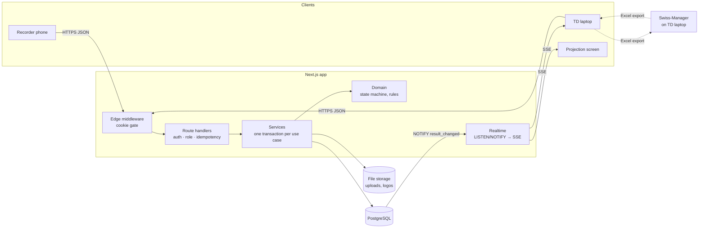
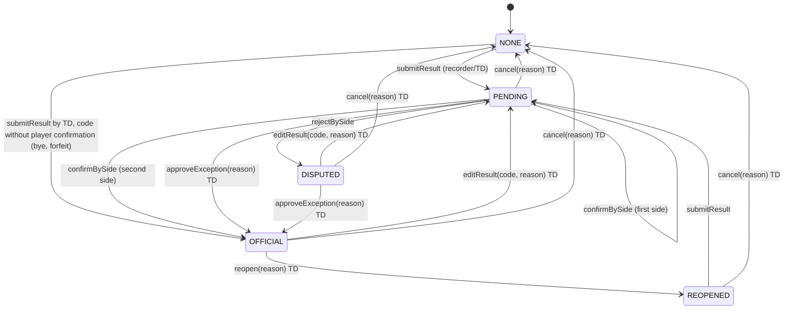

# USCC Referee Results Web

Internal web app for **USCC** (a chess club in Ho Chi Minh City) that lets arbiters run tournament results without printed pairing lists.

> **Status: Phase 5 (Deployment and hardening) complete — all five phases built.** The app covers accounts, tournaments, manual and Excel pairing import, the recording flow with two-player confirmation, the TD console, live updates, the projection screen, the offline queue and export. Phase 5 adds the production Docker stack with Caddy HTTPS, backups with a tested restore, login lockout, CSRF tokens and structured logs. **Before the first live tournament:** run the drill on the real server, and resolve the open questions in §11 (real Swiss-Manager file, result codes, dispute procedure, hosting and retention).

---

## 1. Introduction

**Who uses it**

- **Technical arbiter (TD, `TECHNICAL`)**: creates tournaments, imports pairings exported from Swiss-Manager, resolves disputes, opens the projection screen, exports results back to Swiss-Manager, and manages accounts.
- **Result recorder (`RECORDER`)**: finds a board on their phone, enters the result, then hands the phone to White and then to Black, who confirm in turn. Players have no accounts.

**Problem it solves.** At venues with no printer, players crowd the arbiter's laptop to find their board, results are relayed by voice or paper slips, and wrong results are found only after the next round is paired. The app gives arbiters a fast, verified and logged channel between the playing area and Swiss-Manager.

**Core rule.** A result becomes **OFFICIAL** only after both players confirm it, or after a TD approves an exception with a reason. Only official results appear on the projection screen and in default exports.

**Out of scope (v1).** The app does not:

- generate pairings, tiebreaks or official standings (Swiss-Manager does this),
- connect directly to the Swiss-Manager database (Excel files only),
- have a native mobile app, registration, payments or membership management,
- have player or spectator accounts, or any public page,
- resolve disputes automatically (the TD decides),
- calculate ratings or publish to Chess-Results.

## 2. Features

| Role | Feature | Status |
|---|---|---|
| Both | Login / logout; sessions end after 16 h of inactivity | ✅ Phase 1 |
| Both | Home page with tournaments and links to each round | ✅ Phase 2 |
| TD | Account management: create, deactivate, reactivate, reset password | ✅ Phase 1 |
| TD | Create tournaments; edit details, colours (contrast warning), logo and result codes | ✅ Phases 2–3 |
| TD | Manual pairing entry | ✅ Phase 2 |
| Both | Pairing list with search by board, name (diacritics ignored) or player ID | ✅ Phase 2 |
| Both | Result entry and two-player confirmation on the recorder's phone | ✅ Phase 2 |
| TD | Console: dispute queue, approve / edit / cancel / reopen with reason, audit history | ✅ Phase 2 |
| TD | Live projection screen: official results only, within 5 s (measured p95 ≈ 0.1 s locally), paging, offline banner | ✅ Phase 3 |
| Both | Round list and console update live, with a connection indicator | ✅ Phase 3 |
| Recorder | Offline queue with "Chưa đồng bộ (N)" badge; each action applied exactly once on reconnect | ✅ Phase 3 |
| TD | Excel import wizard: manual column mapping, preview with sheet/row/column errors, player matching without auto-merge, diff and replace protection | ✅ Phase 4 |
| TD | Excel export for a round or the whole tournament: official only by default, separate reconciliation file | ✅ Phase 4 (layout provisional, OI-02) |
| Ops | Production Docker stack (app, PostgreSQL, Caddy HTTPS, backups), `admin:create`, login lockout, CSRF tokens, structured logs, hourly maintenance | ✅ Phase 5 (Sentry: awaiting approval) |

## 3. Architecture overview

**Stack:** TypeScript (strict) · Next.js 15 App Router · React 19 · Tailwind CSS 3 · PostgreSQL 16 · Prisma 5 · Zod 3 · argon2 · ExcelJS *(Phase 4)* · Server-Sent Events over PostgreSQL LISTEN/NOTIFY *(Phase 3)* · IndexedDB via `idb` *(Phase 3)* · Vitest · Playwright · Docker Compose + Caddy.



**Request pipeline (every authenticated API route).** Same-origin check on mutations → session lookup in the database (401) → role permission from the SRS §4.1 matrix (403) → Zod validation (400) → `Idempotency-Key` check and one transaction that holds both the change and the stored response → JSON error `{ code, messageVi }`.

**Result lifecycle** (implemented in Phase 2 in `src/server/domain/result-state-machine.ts`, the only code allowed to change a result's status):



`editResult` is also allowed from PENDING and REOPENED (back to PENDING); `editResult` and `cancel` are never allowed from NONE. Every TD reason (approve, reopen, edit, cancel) must be at least 5 characters (SRS-SM-05 to SRS-SM-08).

Every transition checks and increments `version` (409 on a stale version), writes a `result_events` row, and fires `NOTIFY result_changed`, all in one transaction. `result_events` is append-only, enforced by a database trigger.

## 4. Project structure

```
src/
  app/                  routes and route handlers only (no business logic)
    api/auth/           login, logout (the only public API route is login)
    api/users/          account management API (TD)
    api/tournaments/    tournaments, result codes, round games and manual boards
    api/games/          one game, its history, and the six result actions
    admin/users/        account management page (TD)
    tournaments/        TD list; [id]/settings, [id]/console, [id]/rounds/[n] and /manual
    record/[gameId]/    mobile result entry and two-player confirmation
    login/  forbidden/  public login page; access-denied page
  components/           presentational React components
  client/               browser-only code: API calls with Idempotency-Key, realtime/ (SSE hook), offline/ (IndexedDB queue, sync engine, offline prediction)
  i18n/vi.ts            every Vietnamese UI string
  middleware.ts         Edge gate: no session cookie → /login or 401
  server/
    auth/               password hashing, session tokens and store, cookies, permission matrix, guards
    config/             validated environment variables
    database/           shared Prisma client and transaction client type
    domain/             pure business rules (no DB, no HTTP)
    http/               ApiError, the route-handler wrapper, result-action route factory, page loaders
    services/           DB-backed use cases: auth, accounts, idempotency, tournaments, result codes,
                        manual pairings, the result lifecycle, game queries
    validation/         Zod schemas for request bodies and queries
    realtime/           PostgreSQL LISTEN connection (pg), in-process event hub, SSE stream builder
    storage/            FileStorage interface + local-disk implementation (logos; workbooks in Phase 4)
    import/             PairingImporter interface + ExcelJS column-mapping implementation
    export/             ResultExporter interface + generic workbook implementation
prisma/                 schema.prisma, migrations/, seed.ts
tests/
  unit/                 pure modules (Vitest)
  integration/          services and route handlers against the test database (Vitest)
  e2e/                  browser flows (Playwright: mobile 390×844, desktop 1440×900, projection 1920×1080)
  fixtures/             anonymized Chess-Results workbook and the script that builds it
  helpers/              test database preparation, tournament and workbook builders
docker/                 Dockerfile (runner + tools images), Caddyfile, backup/ (backup, schedule, restore scripts), drill/ (clean-host drill)
docs/                   BRD, SRS, PRD, technical notes, Chess-Results sample workbook
```

## 5. Prerequisites

| Tool | Version used for development | Minimum |
|---|---|---|
| Node.js | 24.x | 20 LTS |
| pnpm | 12.x | 9 |
| Docker (with Compose v2) | Docker Desktop 4.x / Engine 29 | Compose v2 |
| PostgreSQL | 16 (via the `postgres:16-alpine` image) | 16 |

On Windows, run the commands below in Git Bash or PowerShell.

## 6. Setup, step by step

1. **Clone and install.**
   ```bash
   git clone <repository-url> uscc-referee-results
   ```
   ```bash
   cd uscc-referee-results
   ```
   ```bash
   pnpm install
   ```
   `pnpm install` also runs `prisma generate`. Native builds (argon2, Prisma engines, esbuild) are allowed in `pnpm-workspace.yaml`.

2. **Create your environment file.**
   ```bash
   cp .env.example .env
   ```
   Change `POSTGRES_PASSWORD` and the matching password inside `DATABASE_URL` and `TEST_DATABASE_URL` if you like; the defaults work locally.

3. **Start PostgreSQL.**
   ```bash
   docker compose up -d
   ```

4. **Apply migrations.**
   ```bash
   pnpm db:migrate
   ```

5. **Seed demo data**: one TD, one recorder, the tournament "Giải Demo USCC 2026" with 2 rounds × 10 boards, 20 fictional players and the default result codes. Safe to re-run.
   ```bash
   pnpm db:seed
   ```

6. **Start the dev server** and open http://localhost:3000.
   ```bash
   pnpm dev
   ```

**Demo logins (local development only):**

| Role | Username | Password |
|---|---|---|
| TECHNICAL | `td_demo` | `TdDemo-2026!` |
| RECORDER | `recorder_demo` | `RecDemo-2026!` |

Override them with the `SEED_*` variables before seeding. Never use these accounts on a deployed server.

### Environment variables

| Variable | Required | Meaning |
|---|---|---|
| `DATABASE_URL` | yes | PostgreSQL URL used by Prisma and the app. |
| `POSTGRES_DB`, `POSTGRES_USER`, `POSTGRES_PASSWORD`, `POSTGRES_PORT` | for docker compose | Initialise the PostgreSQL container; must match `DATABASE_URL`. |
| `TEST_DATABASE_URL` | for integration tests | Separate database; its name must contain `test`. Created and migrated automatically by `pnpm test:integration`. |
| `APP_URL` | yes in production | Public origin, e.g. `https://kq.example.org`. Mutations whose `Origin` header differs are rejected. Default `http://localhost:3000`. |
| `SESSION_IDLE_TIMEOUT_HOURS` | no | Hours of inactivity before a session ends (SRS-AUTH-04). Default `16`. |
| `SESSION_COOKIE_SECURE` | no | `true`/`false` to force the cookie's Secure flag. Default: on in production, off in development. |
| `NODE_ENV` | no | `development`, `test` or `production`. |
| `SEED_TD_USERNAME`, `SEED_TD_PASSWORD`, `SEED_RECORDER_USERNAME`, `SEED_RECORDER_PASSWORD` | no | Override the demo accounts created by `pnpm db:seed`. |
| `UPLOAD_DIRECTORY` | no | Folder for uploaded files (logos now, pairing workbooks in Phase 4). Default `./storage/uploads`. It must persist and be backed up. |
| `SENTRY_DSN` | no | Reserved for Sentry. The error-reporting hook is in place (`registerErrorReporter`), but the Sentry SDK is **not installed** until its dependency is approved. Errors are written as JSON log lines with a request ID. |

Older `.env` files may still contain `SESSION_SECRET`, `SESSION_MAX_AGE_SECONDS` and `NEXT_PUBLIC_APP_URL`. Nothing reads them any more, because sessions are random tokens stored in the database. Remove them.

## 7. Usage guide

### Technical arbiter (TD)

**Create an arbiter account**
1. Sign in at `/login` with a TECHNICAL account.
2. Click **Tài khoản** in the header (`/admin/users`).
3. Under **Tạo tài khoản mới**, enter a username (3–40 characters: lowercase letters, digits, `.`, `_` or `-`), a password of at least 10 characters, and a role. Click **Tạo tài khoản**.
4. To lock someone out, click **Vô hiệu hóa**. Their sessions end immediately. You cannot deactivate yourself or the last active TD.
5. To change a password, click **Đặt lại mật khẩu**. The user's existing sessions end.

The first TD account comes from the seed script in development. For production, see §9.

**Create a tournament**
1. Click **Giải đấu** in the header (`/tournaments`).
2. Fill in **Tạo giải đấu mới**: name, dates, venue, organizer, number of rounds (1–20), timezone and colours. A yellow note warns when a colour gives white text a contrast below 4.5:1. Click **Tạo giải đấu**.
3. You land on the settings page. Rounds 1..n exist, and the nine default result codes are listed under **Mã kết quả**. **Confirm or adjust the codes before round 1** (OI-03): edit a row and click **Lưu**, **Ẩn** a code you do not use, or add one with **Thêm mã**. A code already used by a result can only be hidden, relabelled, re-ordered or given a new Swiss-Manager value.

**Enter pairings manually** (one board at a time; for a whole round use the import below)
1. On the settings page, under **Nhập cặp đấu**, click the round.
2. For each board, enter the board number, then White's Swiss-Manager ID, name, club and points before the round, and the same for Black. Leave Black's name empty for a bye. Click **Lưu bàn**.
3. Players are matched by ID first. Without an ID, a name matches only if exactly one existing player has it. The form refuses, with a Vietnamese message:
   - an ID that belongs to a differently named player,
   - a name shared by several players,
   - a player already on another board,
   - a duplicate board number.

   Players are never merged automatically.
4. **Sửa** edits a board, and **Xóa** deletes one. A board whose result is not "Chưa có kết quả" cannot be changed: cancel the result in the console first.

**Resolve results in the console** (`/tournaments/[id]/console`)
1. Pick the round. The counters show games per status.
2. **Hàng chờ bất đồng** lists disputed results across all rounds, oldest first, with who disagreed and when.
3. Click **Xử lý** on a game. Depending on its status you can:
   - **Duyệt ngoại lệ**: approve as an exception, optionally choosing another code;
   - **Sửa kết quả**: pick a new code; the players must confirm again;
   - **Mở lại**: reopen an official result;
   - **Hủy kết quả**: cancel, back to "Chưa có kết quả".

   Every action needs a reason of at least 5 characters.
4. **Lịch sử thay đổi** lists every event for the game: time in the tournament timezone, account, action, old → new status and reason.
5. Byes and forfeits: open **Mở trang ghi kết quả** and choose the code. It becomes official at once and is never shown as confirmed by both players.

**Upload a logo**
1. On the settings page, under **Logo**, choose a PNG, JPEG or SVG file (at most 2 MB) and click **Tải lên**.
2. The file type is checked from the file's content, not its name. The logo appears on the projection screen within seconds.

**Open the projection screen**
1. Connect the laptop to the projector and sign in as a TD.
2. Click **Màn hình trình chiếu** on any tournament page. It opens in a new tab at `/tournaments/[id]/projection`. Press F11 for full screen.
3. The screen shows the latest round that has pairings. Add `?round=2` to pick a round, and `&pageSeconds=15` to change how fast pages rotate when the round does not fit one screen (5–30 s, default 10 s).
4. Only official results are shown. Pending, disputed and reopened results leave the cell empty. Byes show **Miễn đấu**. Points in brackets are provisional points from the pairing data.
5. **Cập nhật lúc HH:mm:ss** shows the last successful sync. If the connection drops, a red banner appears and the last data stays on screen. The screen reconnects by itself (1 s, 2 s, 4 s … up to 30 s) and reloads everything when it is back.

**Import pairings from Excel** (`/tournaments/[id]/import`, or **Nhập từ Excel** on any tournament page)
1. **Tải tệp:** choose the round and an `.xlsx` file of at most 5 MB, then click **Tải lên**. Other file types are refused.
2. **Chọn trang tính:** pick the sheet. The header row is detected as the first row with at least 4 text cells; check it against the preview of the first rows and change it if needed.
3. **Ánh xạ cột:** for each piece of information, choose the column that holds it. Board number, White name and Black name are required; IDs, clubs and points are optional. Nothing about the layout is assumed. From the second import on, the previous mapping is filled in. The result column is shown for reference only and is never imported.
4. **Xem trước:**
   - Every problem is listed as `Sheet "…", dòng N, cột X: …`: missing values, bad board numbers, duplicate boards, points not in 0.5 steps, a player on two boards, an ID that belongs to another name.
   - Fix the file and upload it again, or tick **Bỏ qua dòng này** for each row to leave out.
   - When a name without an ID matches several players, choose the right one or **Tạo kỳ thủ mới**. Players are never merged automatically.
   - Rows with no player names (blank lines, source footers) are skipped and listed.
   - **The diff** shows boards added, removed, with changed players, or with changed points. Boards that already have a result are marked in red, and replacing them needs the extra tick **Tôi xác nhận thay thế…**. Their results are cancelled through the normal "Hủy kết quả" action, with a reason in the history.
   - A board with result history cannot be removed by an import at all.
5. **Xác nhận nhập:** the whole round is written in one transaction, or nothing is. The import is logged (file name, SHA-256, stored file, uploader, time, row count, excluded rows, messages).

**Export results to Excel** (`/tournaments/[id]/export`, or **Xuất Excel**)
1. Choose **Toàn giải** or one round.
2. Leave **Kết quả chính thức** selected for the file to enter into Swiss-Manager. Choose **Đối soát** for a separate file of results that are not official yet (pending, disputed, reopened).
3. Click **Tải tệp Excel**. The file has a header block (tournament, scope, content, generation time in the tournament timezone) and one row per game: round, board, White ID and name, Black ID and name, the result's Swiss-Manager value, the result in words, and the status. Byes show **Miễn đấu**.
4. **Before the first tournament**, test-import this file into USCC's Swiss-Manager (PRD acceptance; OI-02). The layout is provisional and lives in one module (`src/server/export/generic-result-workbook-exporter.ts`) so it can be changed alone.

### Recorder

1. Sign in at `/login` on your phone with a RECORDER account.
2. On the home page, tap the round. Search by board number, a player's ID, or a name. Diacritics are optional: "nguyen van an" finds "Nguyễn Văn Ân".
3. Tap the board, then tap the result (e.g. **1 – 0 Trắng thắng**).
4. Read the review screen back: White, Black, the score and the result in words. Tap **Gửi cho kỳ thủ xác nhận**, or **Sửa** to choose again.
5. **Check you have the right player, then hand the phone to White.** White's screen shows only White's name, the side and the result. White taps **Xác nhận** or **Không đồng ý**. The buttons lock after one tap.
6. Tap **Tiếp tục: đưa máy cho kỳ thủ Đen** and hand the phone to Black, who does the same.
7. The final screen shows the status. Two confirmations make it **Chính thức**. Any "Không đồng ý" makes it **Có bất đồng** and sends it to the TD. Tap **Về danh sách**.
8. If the page closes mid-flow, open the board again: it resumes at the first player who has not confirmed yet.
9. If another arbiter changed the board meanwhile, you see "Kết quả đã thay đổi. Vui lòng tải lại." Tap **Tải lại**.
10. Byes and forfeits are entered by the TD only.
11. **No network?** Carry on. Each action is saved on the phone, and the header shows a yellow **Chưa đồng bộ (N)** badge. The flow continues as normal: White, then Black, then the final screen.
    - Actions are sent automatically, in order, when the network returns. Tap the badge to send them immediately.
    - Each action is applied exactly once, even if it is retried.
    - The queue survives closing the page or the browser, but it is tied to your account: stay signed in until the badge disappears.
    - If another arbiter changed the board in the meantime, a red notice explains which action was not sent and why. Check that board.

## 8. Testing

| Command | What it runs | Needs |
|---|---|---|
| `pnpm lint` | ESLint (Next.js + TypeScript rules, zero warnings allowed) | — |
| `pnpm typecheck` | `tsc --noEmit` in strict mode | — |
| `pnpm test:unit` | Vitest, `tests/unit`: **every result action × status × role against the SRS §7 table**, confirmation guards, byes and TD reasons; the offline sync engine (order, same key, backoff, drop-and-report, 401 keep, owner filter) and offline prediction; retry backoff, projection paging, logo type detection, SSE/NOTIFY parsing; session tokens, argon2, the permission matrix, origin check, Zod schemas, deactivation rules, date formatting, ½ display, search, contrast, manual pairing rules, default result codes, idempotency keys; import rules (column letters, board/points parsing, header detection, byes, per-cell issues, player resolution, diff), the export layout read back with ExcelJS, cell text conversion; login lockout rule, CSRF token derivation and comparison, log redaction | — |
| `pnpm test:integration` | Creates and migrates `TEST_DATABASE_URL`, then Vitest `tests/integration`: sessions, accounts, idempotency, real route handlers (401, 403, origin, missing key, cookie flags, recorder 403s on TD routes, idempotent retry), the append-only trigger; the result lifecycle (full flow, dispute → approval, stale version, simultaneous submits, byes, hidden codes, reopen/edit/cancel); tournament and pairing services; **a committed transition reaches an open SSE stream through LISTEN/NOTIFY and a rolled-back one does not**; streams close when the session ends; the projection carries only OFFICIAL results; logo upload (type, size, path traversal); **the anonymized Chess-Results fixture imported through manual mapping (40 boards, footer skipped, logged, mapping saved)**; **malformed workbooks giving sheet/row/column errors that block confirmation until excluded**; file type/size/mapping errors; re-import replacing a board with a result only after the second confirmation (result cancelled with an audit event); an all-or-nothing confirm; **an export of the real seed script's tournament containing only OFFICIAL results by default**, plus the reconciliation file; **CSRF token required on mutations and live-session logout; 5 failed logins lock the username (429 + Retry-After) without extending the lock, unknown usernames too; maintenance deletes only expired rows** | Docker PostgreSQL |
| `pnpm test:e2e` | Playwright on mobile (390×844), desktop (1440×900) and projection (1920×1080): auth flows; enter → White → Black → OFFICIAL; reject → DISPUTED → TD approves; TD tournament setup; **projection latency over 20 iterations (each < 5 s, p95 printed)**; disputed results never projected; offline banner and reconnect; **offline → reload → online syncs exactly once**; **a lost response is retried with the same key and applied once** ; **TD imports the fixture with the wizard by manual mapping and downloads an export containing only the official result** | Docker PostgreSQL, `pnpm db:seed`; starts `pnpm dev` itself if not running |
| `pnpm test:all` | unit + integration + e2e | all of the above |

Run `pnpm exec playwright install chromium` once before the first e2e run. Failure traces, screenshots and videos are saved in `test-results/`, and the HTML report in `playwright-report/`. The `.docx` test-run report generator (TEST_AGENT_PROMPT.md) is not built yet.

## 9. Deployment

**Target:** one small Linux VPS (e.g. Singapore region) with Docker Engine and the Compose plugin, ports 80 and 443 open, and a DNS name pointing at it. The stack is defined in `docker-compose.prod.yml`:

| Service | What it does |
|---|---|
| `postgres` | PostgreSQL 16. Reachable only inside the Docker network (no published port). |
| `migrate` | Runs once on every start: `prisma migrate deploy`. The app waits for it to succeed. |
| `app` | The Next.js standalone server as a non-root user, port 3000 internal only. Uploads live on the `uploads` volume. |
| `caddy` | HTTPS on 80/443 with automatic Let's Encrypt certificates, HSTS and security headers. Live updates (`/events`) pass through unbuffered. |
| `backup` | `pg_dump` plus an uploads archive every `BACKUP_INTERVAL_MINUTES` (default 15) into the `backups` volume, pruned after `BACKUP_RETENTION_DAYS`. |
| `tools` | Started on demand only: `pnpm admin:create`, seeding, ad-hoc commands. |

**First deployment**
1. Install Docker Engine with the Compose plugin and git on the server, and point the DNS name at it.
2. Clone and configure:
   ```bash
   git clone <repository-url> uscc-referee-results
   ```
   ```bash
   cd uscc-referee-results && cp .env.production.example .env.production
   ```
   Edit `.env.production`:
   - `DOMAIN` is the DNS name;
   - `APP_URL` is `https://<DOMAIN>`;
   - `POSTGRES_PASSWORD` must be strong (`openssl rand -base64 24 | tr -d '/+='`);
   - `BACKUP_*` set the schedule (see Backups below).
3. Build and start. The first build downloads the images and dependencies and takes several minutes.
   ```bash
   docker compose -f docker-compose.prod.yml --env-file .env.production up -d --build
   ```
4. Create the first TD account. There is no public signup; the password comes from an environment variable, not a command-line argument.
   ```bash
   docker compose -f docker-compose.prod.yml --env-file .env.production run --rm -e ADMIN_USERNAME=td_admin -e ADMIN_PASSWORD='<long password>' tools pnpm admin:create
   ```
5. Open `https://<DOMAIN>/login`, sign in, and create the other arbiter accounts and the tournament. Do **not** run `pnpm db:seed` on a production server: it creates demo accounts with known passwords.

**Updating to a new version**
```bash
git pull && docker compose -f docker-compose.prod.yml --env-file .env.production up -d --build
```
Migrations run automatically before the new app starts. A backup is taken every 15 minutes anyway, but take one by hand first (below).

**Backups** (BR-14, NFR-06: recovery point ≤ 15 minutes)
- The `backup` service writes `db-<UTC time>.dump` (PostgreSQL custom format, verified with `pg_restore --list`) and `uploads-<UTC time>.tar.gz` to the `backups` volume every `BACKUP_INTERVAL_MINUTES`. It deletes files older than `BACKUP_RETENTION_DAYS`, but only after a successful run.
- Take a backup now:
  ```bash
  docker compose -f docker-compose.prod.yml --env-file .env.production exec backup sh /backup-scripts/backup-database.sh
  ```
- List backups:
  ```bash
  docker compose -f docker-compose.prod.yml --env-file .env.production exec backup ls -lh /backups
  ```
- **Copy backups off the server** (SRS §9 requires storage separate from the server). Until a provider is chosen (OI-05), copy the volume to another machine at least daily, e.g. from a host cron job with `rsync` or `rclone`. The volume path is shown by `docker volume inspect uscc-referee_backups`.
- **Host cron alternative** to the built-in loop (set `BACKUP_INTERVAL_MINUTES` very high, or stop the `backup` service, and add to `crontab -e`). This takes a backup every 15 minutes on tournament days and daily at 03:00 otherwise:
  ```
  */15 7-22 * * 6,0 cd /opt/uscc-referee-results && docker compose -f docker-compose.prod.yml --env-file .env.production run --rm --entrypoint sh backup /backup-scripts/backup-database.sh >> /var/log/uscc-backup.log 2>&1
  0 3 * * * cd /opt/uscc-referee-results && docker compose -f docker-compose.prod.yml --env-file .env.production run --rm --entrypoint sh backup /backup-scripts/backup-database.sh >> /var/log/uscc-backup.log 2>&1
  ```

**Restore** (NFR-06: recovery time ≤ 30 minutes). Destructive: it replaces the whole database and, if an archive is given, the uploaded files.
1. Pick the files (`ls -lh /backups` above). If the server was lost, copy them into the `backups` volume of a freshly deployed stack (steps 1–3 above).
2. Stop the app so nothing writes during the restore:
   ```bash
   docker compose -f docker-compose.prod.yml --env-file .env.production stop app caddy
   ```
3. Restore:
   ```bash
   docker compose -f docker-compose.prod.yml --env-file .env.production run --rm -e CONFIRM_RESTORE=yes --entrypoint sh backup /backup-scripts/restore-database.sh /backups/db-<time>.dump /backups/uploads-<time>.tar.gz
   ```
4. Start again; migrations re-run harmlessly:
   ```bash
   docker compose -f docker-compose.prod.yml --env-file .env.production up -d
   ```
5. Sign in and check the latest results in the console. Results recorded after the backup must be re-entered. Their recorders' phones may still hold them in the offline queue; those that conflict are reported on the phones.

**Clean-host drill** (Phase 5 acceptance: README followed end to end, backup restored). `docker/drill/clean-host-drill.sh` scripts this section exactly, on any clean Linux host with Docker, git and curl:
1. Clone, configure, `up --build`.
2. `admin:create`.
3. HTTPS login through Caddy, checking HSTS and the Secure/HttpOnly cookie flags.
4. API with the CSRF token; a mutation without it must get 403.
5. SSE through Caddy.
6. Back up, then change data.
7. Restore.
8. Verify the post-backup change is gone and the backed-up data (and the append-only trigger) is back.

On a real VM:
```bash
sh docker/drill/clean-host-drill.sh <repository-url> <branch>
```
On a developer machine, `sh docker/drill/run-drill-in-container.sh` runs it inside a throwaway Docker-in-Docker container acting as the clean host.

**Last drill run (2026-10-31, branch `feat/phase-5-deployment-hardening`): PASSED in 168 s.** The clean host was a fresh `docker:27-dind` container with nothing but Docker, git and curl; the branch was handed over as a git bundle, so the drill really cloned. Results:
- **Fresh build:** `pnpm install --frozen-lockfile` and `next build` ran from scratch, compiling in 8.7 s. All five services started; `migrate` applied the migrations before `app` started.
- **First account:** `pnpm admin:create` created the TD `td_admin`.
- **HTTPS:** login through Caddy returned 200, with HSTS present and the session cookie `HttpOnly` and `Secure`. Plain HTTP redirected with 308 to HTTPS.
- **CSRF:** a mutation without the token got 403; with it, the recorder and the tournament were created.
- **Live updates:** the SSE `ready` event arrived through Caddy within 3 s.
- **Backup:** `db-20261031T002533Z.dump` (33 KB, verified) and the uploads archive were written.
- **Restore:** a recorder created after the backup was gone afterwards; the backed-up recorder and tournament were back, and so was the append-only trigger on `result_events`.

**Not covered by the drill:** a real public domain with a Let's Encrypt certificate (the drill uses `localhost` with Caddy's local CA), off-server backup copies, and measuring recovery time on the real server. Do these on the production VPS before the first tournament.

**Security checklist for go-live:**
- HTTPS only; HSTS comes from Caddy.
- Strong `POSTGRES_PASSWORD`, and the database is not exposed.
- No demo seed on the server.
- Every arbiter has their own account, and departing arbiters are deactivated.
- Backups are copied off the server.
- The drill has been run once on the real server.

## 10. Configuration reference

**Result codes.** Each tournament has its own list (`result_codes`). New tournaments get the SRS-TOUR-06 defaults below. **The list and the Swiss-Manager values are a proposal (open question OI-03); the TD must confirm them before round 1.**

| Code | Label | White | Black | Players confirm? | Swiss-Manager value (placeholder) |
|---|---|---|---|---|---|
| `1-0` | Trắng thắng | 1 | 0 | yes | `1-0` |
| `0-1` | Đen thắng | 0 | 1 | yes | `0-1` |
| `½-½` | Hòa | ½ | ½ | yes | `½-½` |
| `+/-` | Trắng thắng do Đen bỏ cuộc | 1 | 0 | no | `+/-` |
| `-/+` | Đen thắng do Trắng bỏ cuộc | 0 | 1 | no | `-/+` |
| `-/-` | Cả hai bỏ cuộc | 0 | 0 | no | `-/-` |
| `BYE` | Miễn đấu (1 điểm) | 1 | 0 | no | `+` |
| `BYE½` | Miễn đấu (½ điểm) | ½ | 0 | no | `½` |
| `BYE0` | Miễn đấu (0 điểm) | 0 | 0 | no | `-` |

Codes with "Players confirm? = no" go straight to OFFICIAL when a TD submits them, and are never displayed as "confirmed by both players". Scores are stored as `DECIMAL` (½ = 0.5) and shown as ½.

**Timezone.** Each tournament has an IANA timezone, `Asia/Ho_Chi_Minh` by default. Timestamps are stored as `timestamptz` (UTC) and displayed as `DD/MM/YYYY HH:mm` (24-hour) in that zone. Tournament start and end dates are calendar dates (`DATE`).

**Branding.** Each tournament has a primary and secondary colour, edited on the settings page with a contrast warning below 4.5:1, plus an optional logo (PNG, JPEG or SVG, ≤ 2 MB, stored under `UPLOAD_DIRECTORY`). The projection screen applies the colours through the CSS variables `--brand-primary` and `--brand-secondary`. SVG logos are served with a sandboxing Content-Security-Policy and shown only as images.

**Realtime.** Every change sends `NOTIFY result_changed` or `NOTIFY tournament_changed` inside its transaction, so it is delivered only on commit. One `pg` connection per app process LISTENs and fans changes out to SSE streams (`GET /api/tournaments/[id]/events`). Streams send a heartbeat every 15 s and re-check the session each time. Clients reconnect with backoff (1 s → 30 s) and reload full state on every reconnect.

**Sessions.** Opaque 256-bit tokens in an `HttpOnly`, `SameSite=Lax` cookie (`Secure` in production). Only the token's SHA-256 hash is stored. Sessions slide forward on activity and end after `SESSION_IDLE_TIMEOUT_HOURS` without activity, on logout, on deactivation or on a password reset.

## 11. Known limitations and open questions

**Open questions (do not guess; owners per SRS §13):**

1. **OI-01:** The real Swiss-Manager pairing export and the Swiss-Manager version USCC uses have not been provided. The importer maps columns by hand and assumes no layout, so it should handle the real file. **Check it with a real export before the first tournament.**
2. **OI-02:** Whether that Swiss-Manager version can re-import results from Excel, and in what layout. Until confirmed, the export is a generic workbook laid out for fast manual entry (RISK-01 fallback), isolated in `generic-result-workbook-exporter.ts`.
3. **OI-03:** The final result-code list and Swiss-Manager values. The defaults in §10 are a proposal. **Assumption:** forfeits and byes do not require player confirmation, because at least one player is absent.
4. **OI-04:** The procedure when a player disputes a result or cannot confirm it personally. Not yet decided. **Phase 2 behaviour:** a rejection sends the result to the TD's dispute queue. When a player cannot confirm, the TD uses **Duyệt ngoại lệ** with a written reason.
5. **OI-05:** Hosting provider, budget and data-retention period.
6. **OI-06:** Session lifetime (16 h implemented) and login-lock thresholds (5 failures in 10 minutes locks the username for 10 minutes, implemented in Phase 5). The TD should confirm both.
7. **OI-07:** Capacity figures (200 players, 10 recorders) are estimates.

**Conflicts between documents** (AGENT_PROMPT.md wins per CLAUDE.md, flagged for a decision):

- *Handled in Phase 4:* AGENT_PROMPT §3.7 asks for the Chess-Results sample as a test fixture, but it contains real player names, and CLAUDE.md forbids real personal data in fixtures. Tests therefore use `tests/fixtures/chess-results-round-1-anonymized.xlsx`. It has the identical layout (sheet, metadata rows 1–5, header row 6, boards in rows 7–46, footer rows, club codes, points, Chess-Results result symbols) with fictional names, and is built by `pnpm exec tsx tests/fixtures/create-anonymized-chess-results-fixture.ts`. The original stays in `docs/`.

- *Resolved 2026-10-30:* the SRS state-machine rules are adopted: `cancel(reason)` → NONE is added, `edit` is allowed from any state except NONE, and TD reasons need at least 5 characters. AGENT_PROMPT §3.3 has been updated to match.
- *Resolved in Phase 5:* login rate limiting (SRS-AUTH-05) and CSRF tokens (SRS §10.2), which AGENT_PROMPT scheduled for Phase 5, are now implemented.

**Current limitations:**

- `/api/auth/login` and `/api/auth/logout` do not require an `Idempotency-Key`. Repeating them is harmless, and the offline queue never replays them. Every other mutating endpoint requires one.
- **Phase 5 notes:**
  - Hourly maintenance deletes expired sessions, idempotency records older than 48 h (SRS §9) and login attempts older than 24 h. Audit events, results and imports are never deleted.
  - The CSRF token is derived from the session token: SHA-256 in a readable SameSite=Strict cookie, echoed in `X-CSRF-Token`. It is required on every authenticated mutation, including uploads, logout of a live session, and offline replays (read at send time, so a replay after re-login still works). Login is exempt; it has no session and is covered by the same-origin check.
  - The login lockout is per username, not per IP address (SRS-AUTH-05). It also applies to unknown usernames, so it does not reveal which accounts exist. A real arbiter locked out by someone else's guessing waits 10 minutes, or a TD can reset their password (which does not lift the lock).
  - There is no public health endpoint (CLAUDE.md §2). The container health check tests the app's TCP port.
  - `pnpm build` on Windows produces a normal build. The Docker image sets `NEXT_OUTPUT_STANDALONE=true` for the standalone server, because creating the standalone output's symlinks fails on Windows without Developer Mode.
  - **Sentry is not installed.** `@sentry/nextjs` is a new dependency and needs approval (CLAUDE.md). The reporting hook is ready.
- Deleting a tournament or result that has audit history is blocked by the append-only trigger by design. There is no delete feature.
- **Assumptions made in Phase 2 (flag if wrong):**
  - Only a TD can submit codes that skip player confirmation (byes, forfeits), per SRS-SM-04. Recorders do not see those codes.
  - A bye game can only take such a code.
  - `editResult` to a bye/forfeit code still goes to PENDING, as SRS-SM-07 says, so the TD then approves it as an exception.
  - Editing or deleting a board whose result is not NONE is refused; the TD cancels the result first. A board with any result history cannot be deleted.
  - A result code that results ever used (now or in the audit log) cannot be deleted, and its code, scores and confirmation flag cannot change.
  - An all-digit search matches the board number or a player ID exactly. Text matches names (diacritics ignored) and IDs by substring.
- The record page is not live-updated, because it shows one game and is refreshed by each action's response. A conflicting change by another arbiter appears as the 409 "Kết quả đã thay đổi" message with **Tải lại**.
- **Realtime is per process:** the LISTEN connection and event hub live in the Next.js process. Run one app instance (the v1 deployment target). Several instances would each need their own listener, which works as is, but is untested.
- **Offline queue scope:** only the recorder actions (submit, confirm, reject) are queued. TD console actions and setup forms need a connection and show an error otherwise. Queued actions belong to the account that made them; another account signing in on the same phone does not send them. There is no offline page cache (no service worker), so the record page must be open before the network drops.
- **Phase 3 dependency added (approved):** `pg` (and `@types/pg`) for PostgreSQL LISTEN. `idb` is part of the original stack.
- **Phase 4 assumptions (flag if wrong):**
  - Black is treated as a bye when its name cell is empty or says `bye`, `spielfrei`, `Miễn đấu` or `-` and there is no Black ID.
  - Rows where every player name/ID cell is empty are skipped and listed rather than reported as errors.
  - A name without an ID that matches no existing player creates a new player (shown as a notice).
  - The reconciliation export includes REOPENED results as well as PENDING and DISPUTED (all are unresolved).
  - The route is `POST /imports` (upload), then `/imports/preview`, then `/imports/:uploadId/confirm`, instead of SRS §10.2's `/imports/preview` and `/imports/:previewId/confirm`. Uploading once lets the TD change sheet and mapping without uploading again.
- Uploaded workbooks are kept under `UPLOAD_DIRECTORY/imports/` as the import log's stored file (SRS-IMP-11). Retention is part of OI-05.
- Under `next dev`, routes compile on first use, so the Playwright timeouts are generous (expect 20 s, test 90 s). Playwright is also capped at 2 workers: the default of half the CPU cores overloaded the dev server, and requests stalled. The flows take about 15 s once compiled.

## 12. Troubleshooting

| Symptom | Fix |
|---|---|
| `pnpm build` fails on Windows with `EPERM … symlink` | You set `NEXT_OUTPUT_STANDALONE=true` locally. Unset it; the standalone output is only needed inside the Docker image. |
| Mutations return `403 CSRF_TOKEN_INVALID` | The page was open across a deployment or the `uscc_csrf` cookie was removed. Reload the page (the middleware re-issues the cookie) or sign in again. |
| Login returns `429` | Five wrong passwords in 10 minutes locked that username. Wait for the time shown, then sign in. |
| Caddy cannot get a certificate | DNS for `DOMAIN` must point at the server, and ports 80 and 443 must be reachable from the internet. See `docker compose -f docker-compose.prod.yml logs caddy`. |
| `migrate` exits with an error and the app does not start | `docker compose -f docker-compose.prod.yml logs migrate`. Usually a wrong `POSTGRES_PASSWORD` compared with an existing `postgres_data` volume. |
| `Can't reach database server at localhost:5432` | Start Docker Desktop, then `docker compose up -d`. Check with `docker compose ps`. If port 5432 is taken, set `POSTGRES_PORT` and update the port in `DATABASE_URL`. |
| `@prisma/client did not initialize yet` | Run `pnpm db:generate` (the client is stale after a schema change). |
| `Invalid server environment — …` on start | A variable in `.env` is missing or malformed. Compare with `.env.example`. |
| Migration fails with `relation already exists` | The dev database has tables from an older schema. Only on your local dev DB: `pnpm exec prisma migrate reset`. This deletes all local data. |
| `ERR_PNPM_IGNORED_BUILDS` during install | Make sure `pnpm-workspace.yaml` is present; it allows the argon2 and Prisma build scripts. |
| Login works but you are immediately sent back to `/login` | You are on plain `http://` with `NODE_ENV=production`, so the `Secure` cookie is dropped. Use HTTPS, or set `SESSION_COOKIE_SECURE=false` for local testing only. |
| Mutations return `403 CROSS_ORIGIN_REJECTED` | `APP_URL` does not match the address in the browser (scheme, host and port must all match). |
| `Refusing to use database … for tests` | `TEST_DATABASE_URL` must name a database containing `test`. |
| Live status shows "Mất kết nối trực tiếp" behind a proxy | Disable response buffering for `/api/tournaments/*/events` (the app sends `X-Accel-Buffering: no`; Caddy streams by default), and allow idle connections longer than the 15 s heartbeat. |
| Logo upload returns 500 | `UPLOAD_DIRECTORY` is not writable by the app user. Create it and give the app user write access. |
